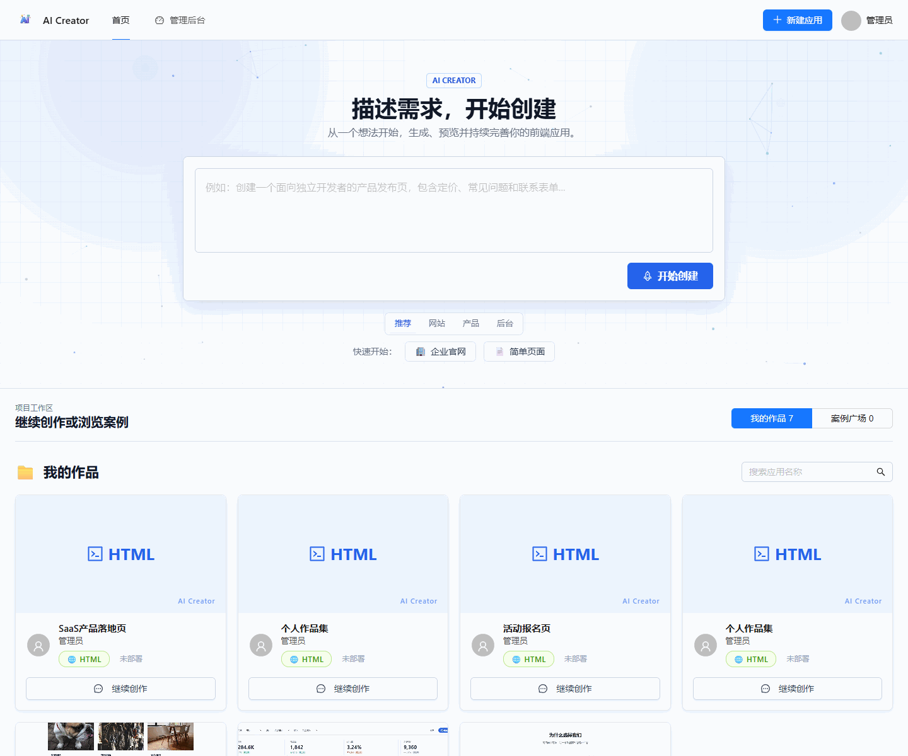
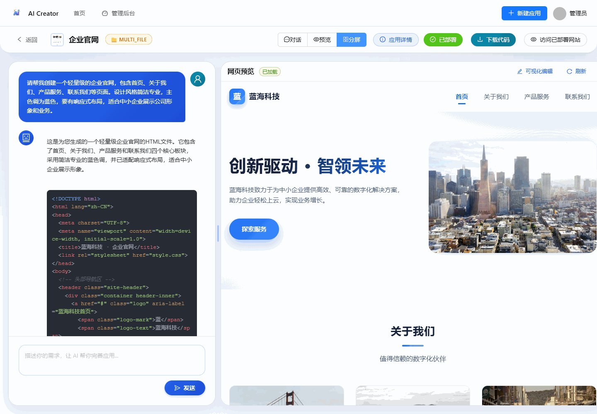
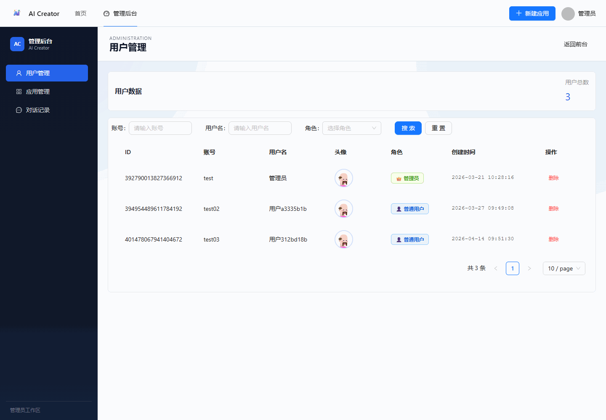
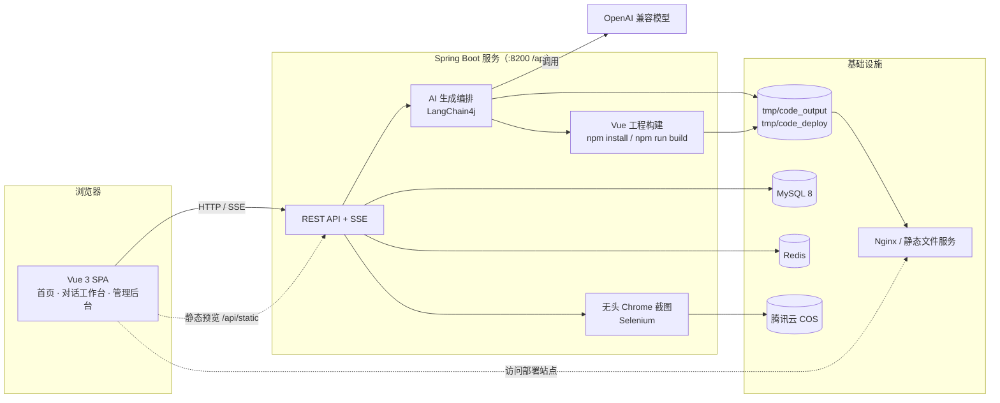

<p align="center">
  
</p>

<h1 align="center">AI Creator</h1>

<p align="center">用自然语言描述需求，AI 生成可预览、可部署、可下载的前端页面源码</p>

<p align="center">
  
  
  
  
  
  
</p>

## 项目简介

AI Creator 将「描述需求 → 得到一个页面」变成一条完整的交互式工作流：AI 先判断该生成单文件、多文件还是 Vue 工程，再通过 SSE 流式产出代码；生成结果可直接在线预览，也能继续多轮对话修改、在预览中点选元素精确修订，最后一键部署或下载 ZIP 源码。

平台面向希望快速把想法变成可访问页面的开发者与创作者，覆盖从创建、生成、编辑到部署的完整闭环。

## 界面预览







## 核心功能

- **自然语言创建**：输入一句话需求即可创建应用，AI 自动判断生成类型并生成应用名称。
- **SSE 流式生成**：基于 Reactor `Flux` 实时推送生成过程，代码边生成边展示。
- **多轮对话迭代**：每个应用拥有独立的对话上下文（Redis 记忆），可持续修改已生成的页面。
- **可视化编辑**：在预览 iframe 中点选页面元素，其标签、选择器与文本会自动拼入下一轮 prompt。
- **在线预览与部署**：生成产物通过静态资源接口直接预览；一键部署后返回可访问地址。
- **自动封面截图**：部署后使用无头 Chrome 异步截图，并将封面存入腾讯云 COS。
- **源码下载**：将生成的工程打包为 ZIP 导出。
- **作品与案例广场**：登录用户管理「我的作品」，未登录用户可浏览精选案例。
- **管理后台**：用户、应用与对话记录的集中管理。

### 生成类型

| 类型 | 产物 | 预览方式 |
| --- | --- | --- |
| `html` | 单个 `index.html` | 直接预览 |
| `multi_file` | `index.html` / `style.css` / `script.js` | 直接预览 |
| `vue_project` | Vite + Vue 源码工程 | 服务端构建出 `dist/` 后预览 |

## 技术栈

| 分类 | 技术 |
| --- | --- |
| 后端 | Java 21、Spring Boot 3.5.9、Spring MVC、Reactor（Flux + SSE）、LangChain4j 1.3.0 |
| 数据 | MySQL 8、MyBatis-Flex 1.11.6、Redis、Redisson、Spring Session Redis、Caffeine |
| 前端 | Vue 3.5、TypeScript 5.9、Vite 7、Pinia、Vue Router 4、Ant Design Vue 4 |
| 前端渲染 | Axios、markdown-it、highlight.js |
| 生成与部署 | 服务端 npm 构建、Selenium 无头 Chrome 截图、腾讯云 COS |
| 可观测性 | Actuator、Micrometer、Prometheus、SpringDoc + Knife4j |

## 系统架构



浏览器通过 Session Cookie 与应用交互；Redis 承担会话、AI 对话记忆与限流；生成产物落在本地 `tmp/code_output`，部署时复制到 `tmp/code_deploy`，由外部静态文件服务对外提供。

## 快速开始

### 环境要求

- JDK 21（自带 Maven Wrapper）
- Node.js `^20.19.0 || >=22.12.0`（前端开发，以及 `vue_project` 的服务端构建）
- MySQL 8、Redis
- 可用的 OpenAI 兼容模型端点与 API Key
- 可选：Chrome 与腾讯云 COS（自动封面截图）、Nginx 或等效静态文件服务（部署访问）

### 1. 初始化数据库

```bash
mysql -u root -p < backend/sql/create_table.sql
```

### 2. 配置后端

后端默认激活 `local` profile。参考 [application.yml](backend/src/main/resources/application.yml) 在 `backend/src/main/resources/application-local.yml` 中填写：

- `spring.datasource.*`：MySQL 连接信息
- `spring.data.redis.*`：Redis 连接信息
- `langchain4j.open-ai.*`：模型 `base-url`、`api-key`、`model-name` 等

该文件已被 `.gitignore` 排除，请勿将任何密钥提交到版本库。

### 3. 启动服务

```bash
# 后端：http://localhost:8200/api
cd backend
./mvnw.cmd spring-boot:run    # Windows
./mvnw spring-boot:run        # macOS / Linux
```

```bash
# 前端：http://localhost:5173
cd frontend
npm ci
npm run dev
```

前端开发服务器会将 `/api` 代理到 `http://localhost:8200`。启动后可访问：

- 健康检查：`http://localhost:8200/api/actuator/health`
- 接口文档：`http://localhost:8200/api/doc.html`

如需使用 `vue_project` 生成，后端所在机器还需可执行 `npm`。

## 目录结构

```text
ai-creator/
├── backend/                        # Spring Boot 后端
│   ├── src/main/java/org/cy/aicreator/
│   │   ├── controller/             # 用户、应用、对话、静态资源 API
│   │   ├── service/                # 应用、部署、构建、截图、下载等业务编排
│   │   ├── core/                   # AI 生成入口、输出解析/保存、SSE 处理
│   │   ├── ai/                     # LangChain4j AiService、智能路由、文件写入工具
│   │   ├── config/                 # 模型、Redis、Session、CORS、COS、构建与截图配置
│   │   ├── aimonitor/              # 模型调用指标上报（旁路、异步）
│   │   └── utils/                  # 通用工具（如 package.json 规范化）
│   ├── src/main/resources/
│   │   ├── application.yml         # 公共配置
│   │   └── prompt/                 # 代码生成与智能路由提示词
│   ├── sql/create_table.sql        # 数据库初始化脚本
│   └── AGENTS.md                   # 后端长期约定与已知风险
├── frontend/                       # Vue 3 前端
│   ├── src/pages/                  # 首页、对话工作台、应用编辑、管理后台
│   ├── src/components/             # 全局布局与业务组件
│   ├── src/api/                    # 由 OpenAPI 生成的请求客户端
│   ├── src/utils/visualEditor.ts   # 预览 iframe 可视化编辑
│   ├── vite.config.ts              # 开发服务器与 /api 代理
│   └── AGENTS.md                   # 前端长期约定与已知风险
└── README.md
```

运行期目录 `backend/tmp/code_output`（生成产物）与 `backend/tmp/code_deploy`（部署产物）不纳入版本库。

## 部署说明

- 前端执行 `npm run build`，将 `frontend/dist/` 作为静态站点部署。
- 后端产出的部署文件位于 `backend/tmp/code_deploy/{deployKey}/`，需由 Nginx 或等效静态文件服务对外提供。
- `code.deploy-host`（后端）与 `VITE_DEPLOY_BASE_URL`（前端）必须指向同一个部署入口，否则前端展示的访问地址会不一致。
- 生产配置放在 `application-prod.yml`，同样保持 Git 忽略。

## 相关文档

- [backend/AGENTS.md](backend/AGENTS.md)：后端架构、生成链路、API 约定与已知风险
- [frontend/AGENTS.md](frontend/AGENTS.md)：前端结构、SSE 渲染、权限与跨端协议

本仓库由原先独立的前后端两个仓库合并而成，两段提交历史完整保留在 `backend/` 与 `frontend/` 下。
