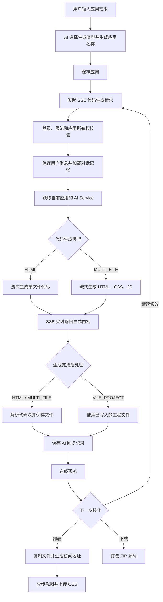

# AI Creator 智能代码生成平台

> 基于 Spring Boot 和 LangChain4j 的 AI 前端代码生成平台，支持自然语言生成、流式输出、在线预览、多轮修改、部署和源码下载。

[](https://openjdk.org/projects/jdk/21/)
[](https://spring.io/projects/spring-boot)
[](https://maven.apache.org/)
[](https://dev.mysql.com/)

## 项目介绍

AI Creator 是一个面向前端页面生成场景的个人项目。用户输入网站需求后，系统通过 AI 判断代码生成类型并创建应用，再以 SSE 流式返回生成过程，最终将代码保存为可预览的项目文件。

用户可以围绕同一个应用继续对话修改代码，也可以部署生成结果、自动截取应用封面或下载 ZIP 源码。本项目主要用于个人学习、毕业设计和校招作品展示，重点实践 AI 应用接入、流式响应、会话记忆和文件生成等完整后端流程。

> 本仓库为 monorepo，Java 后端位于 `backend/`，配套 Vue 3 前端位于同仓库的 [`frontend/`](../frontend)。

## 核心功能

| 功能 | 说明 |
| --- | --- |
| 智能创建应用 | 根据初始需求选择代码生成类型，并自动生成应用名称 |
| 三种生成方式 | 支持 HTML 单文件、HTML/CSS/JS 多文件，以及 Vite + Vue 源码工程（由服务端构建后预览） |
| 流式代码生成 | 使用 Reactor Flux 和 SSE 实时返回 AI 生成内容 |
| 多轮对话 | 保存用户与 AI 消息，结合 Redis 对话记忆继续修改代码 |
| 应用预览 | 按应用和生成类型保存代码，提供静态资源访问能力 |
| 部署与截图 | 复制生成文件到部署目录，并异步截图上传腾讯云 COS |
| 源码下载 | 将生成项目过滤后打包为 ZIP 文件下载 |
| 权限与限流 | 校验登录、应用所有权和管理员角色，并限制 AI 接口调用频率 |

## 核心业务流程



## 技术栈

| 类型 | 技术 |
| --- | --- |
| 后端 | Java 21、Spring Boot 3.5.9、Spring MVC、Spring AOP |
| AI 应用 | LangChain4j、OpenAI-compatible 模型接口 |
| 数据访问 | MyBatis-Flex、MySQL 8 |
| 缓存与会话 | Redis、Spring Session、Caffeine |
| 流式处理 | Reactor Flux、SSE |
| 限流 | Redisson |
| 文件与截图 | 腾讯云 COS、Selenium、Chrome |
| 接口与监控 | Knife4j/OpenAPI、Micrometer、Prometheus |
| 前端 | Vue 3、TypeScript、Vite、Ant Design Vue |

## 实现特点

- 使用 `SmartRoutingService` 根据初始需求选择生成类型并生成应用名称。

- 使用 `AiCreatorFacade` 统一编排模型调用、流式收集、代码解析和文件保存。

- HTML 与多文件模式使用解析器和保存器处理代码块，Vue 模式通过 `FileWriteTool` 写入工程文件。

- 每个应用使用独立的 Redis 对话窗口，最多保留 20 条消息，并从数据库加载历史记录。

- AI Service 按“应用 ID + 生成类型”缓存在 Caffeine 中，减少重复创建服务实例。

- SSE 普通数据帧统一包装为 `{"d":"..."}`，完成后发送 `done` 事件。

- 部署后使用 Java 21 虚拟线程异步执行网页截图和 COS 上传。

  

## 项目结构

```text
src/main/java/org/cy/aicreator/
├── controller/     # 用户、应用、聊天记录和静态资源接口
├── service/        # 应用业务、部署、截图和下载编排
├── ai/             # AI Service、模型工厂、路由和文件工具
├── core/           # 生成门面、代码解析、保存和流处理
├── litmer/         # 基于 Redisson 的注解限流
├── mapper/         # MyBatis-Flex 数据访问
├── model/          # Entity、DTO、VO 和枚举
├── config/         # 模型、Redis、Session、COS 等配置
└── common/         # 通用响应与基础模型
```

## 快速开始

### 环境要求

- JDK 21+
- MySQL 8+
- Redis 6+
- 可用的 OpenAI-compatible 模型服务
- Chrome/Chromium（截图功能需要）
- 腾讯云 COS（应用封面上传需要）

### 1. 初始化数据库

```bash
mysql -u root -p < sql/create_table.sql
```

### 2. 配置开发环境

在 `src/main/resources/` 下创建 `application-local.yml`，配置以下内容：

- MySQL 数据源
- Redis 地址和密码
- AI 模型的 API Key、Base URL 和模型名称
- 腾讯云 COS 的 SecretId、SecretKey、region 和 bucket

该文件已被 Git 忽略，请勿提交真实账号、密码或 API Key。公共配置默认启用 `local` Profile。

### 3. 启动项目

确保 MySQL 和 Redis 已启动，然后执行：

```bash
./mvnw.cmd spring-boot:run
```

服务启动后：

- 接口地址：`http://localhost:8200/api`
- 健康检查：`http://localhost:8200/api/actuator/health`
- Knife4j：`http://localhost:8200/api/doc.html`

### 4. 构建与测试

```bash
./mvnw.cmd test
./mvnw.cmd -DskipTests package
```

> 当前测试以 Spring 上下文加载为主，运行时需要有效的本地配置和可连接的 Redis。

## 主要接口模块

| 路径 | 功能 |
| --- | --- |
| `/user` | 用户注册、登录、退出和后台管理 |
| `/app` | 应用创建、查询、修改、删除和精选列表 |
| `/app/chat/generate/code` | SSE 流式生成或修改代码 |
| `/app/deploy` | 部署应用并生成访问地址 |
| `/app/download/{appId}` | 下载应用 ZIP 源码 |
| `/chatHistory/app/{appId}` | 分页查看应用对话记录 |
| `/static/{deployKey}/**` | 访问已部署的静态资源 |

业务 JSON 接口统一使用 `BaseResponse` 返回，AI 生成接口使用 SSE 协议返回流式内容。


## 项目说明

本项目是应届生个人学习项目，适合用于理解 AI 代码生成平台的基础实现。完整运行需要自行准备数据库、Redis、模型 API 等外部服务，请勿在公开仓库中提交真实凭据。
